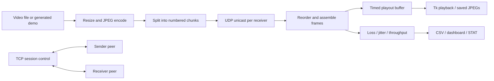

# Architecture and protocol

## Data path

A peer can send and receive. All peers run the same program. During one session the source peer serves multiple receivers directly; this is a one-to-many peer topology, without relaying or a central registration server. Source bandwidth is proportional to receiver count.

## Threads

The sender has an accept loop, one TCP session thread per connection, a discovery responder, and one encoding/transmission scheduler. Each TCP peer has an independent control channel. The single media scheduler fans out packets, with a bounded delay heap for simulated jitter. A join lock protects the peer table. TCP connections are capped at 32. Disconnected or unresponsive peers are removed.

The receiver has a UDP assembly/playout thread and a TCP control/statistics thread. Frames cross a one-item queue to the Tk UI, discarding stale UI frames if rendering is slow. Tk widgets are only changed on the main thread. Network starts/stops/discovery run in a background worker. CLI receivers can save every played JPEG frame.

## Control protocol

UTF-8 JSON objects terminated by a newline, with a 16 KiB input bound. TCP has no message boundaries, so `Channel` preserves partial reads and parses multiple messages independently.

| Message | Direction | Fields / purpose |
|---|---|---|
| JOIN | receiver → sender | `udp_port`: receiver's bound UDP port |
| INFO | sender → receiver | `stream`, `udp_port`, `name`, `fps`, `width`, `codec`, `version` |
| INFO | receiver → sender | request current source information |
| PING | receiver → sender | receiver monotonic `nonce` |
| PONG | sender → receiver | echo nonce for RTT calculation |
| STAT | receiver → sender | receiver statistics dictionary |
| LEAVE | receiver → sender | graceful disconnect |
| END | sender → receiver | source EOF or shutdown |
| ERROR | sender → receiver | invalid JOIN |

JOIN only permits media delivery to the connecting TCP peer's IP address. UDP receivers validate the sender IP, advertised UDP source port, and session stream ID. These checks isolate sessions; they do not provide authentication.

## Media protocol

Network byte order (`!4sQIIHHd`); 32-byte fixed header.

| Offset | Field | Bytes |
|---|---|---|
| 0 | Magic `LVS1` | 4 |
| 4 | Random stream/session ID | 8 |
| 12 | Packet sequence number | 4 |
| 16 | Frame number | 4 |
| 20 | Chunk index, zero-based | 2 |
| 22 | Chunks in this frame | 2 |
| 24 | Sender monotonic timestamp, float64 seconds | 8 |
| 32 | JPEG chunk | 1–1160 |

Largest datagram application payload: 1192 bytes. With IPv4 and UDP headers it is 1220 bytes, below a typical 1500-byte LAN MTU. Frames are at most 2 MB. Receivers keep at most 64 pending frames and 512 recent frame IDs; packet deduplication is bounded as well. Each JPEG can be decoded independently. Chunks are concatenated by index only when every chunk is present; incomplete frames are discarded at their deadline.

The first valid packet anchors local playout time. Frame deadlines use the difference between sender frame timestamps plus the configured buffer. This avoids assuming that monotonic clocks on different machines have the same origin. Buffer size trades delay for tolerance of jitter. A 15 ms minimum assembly window lets multi-packet frames arrive even when the configured buffer is zero. Complete future frames wait until their deadline; frames older than the displayed frame are rejected. There is no retransmission or adaptive congestion control.

## Metrics

- **Loss estimate:** `(highest_sequence - lowest_sequence + 1 - unique_received) / expected × 100`. Late arrivals can fill gaps. The first/last unobserved packet boundaries are unknown. A 100% loss stream has no observable sequence range and therefore reports a zero gap estimate; consult source simulated drops and zero received packets.
- **Jitter:** `J ← J + (|D| - J) / 16`, where `D = (arrival_i - arrival_previous) - (send_i - send_previous)`. Sender timestamp is shared by all chunks of a frame. No synchronized clocks are required. This is an RTP-style estimator used with our custom protocol, not an implementation of RTP.
- **Throughput:** bytes of valid, unique application UDP packets received within the last second × 8 / 1,000,000. The initial partial second is not extrapolated.
- **Average throughput:** valid received bytes × 8 / elapsed seconds.
- **RTT:** receiver monotonic time between sending PING and receiving matching PONG. It measures the TCP control path, including scheduling overhead.
- **FPS:** played complete frames / time since constructing the receiver, including connection/buffering time.
- **Dropped frames:** partially observed frames that expire or are evicted from the bounded buffer. Entirely lost frames are not included.
- **Late frames:** first packets of a new frame that arrive more than 100 ms beyond its playout deadline. Packets from already played frames are ignored.

CSV reports use these same definitions. Metrics reflect application behavior and can differ from Wireshark's link/IP byte counts. Sender simulated losses happen before the OS sends packets, so they are absent from sender-side captures.
